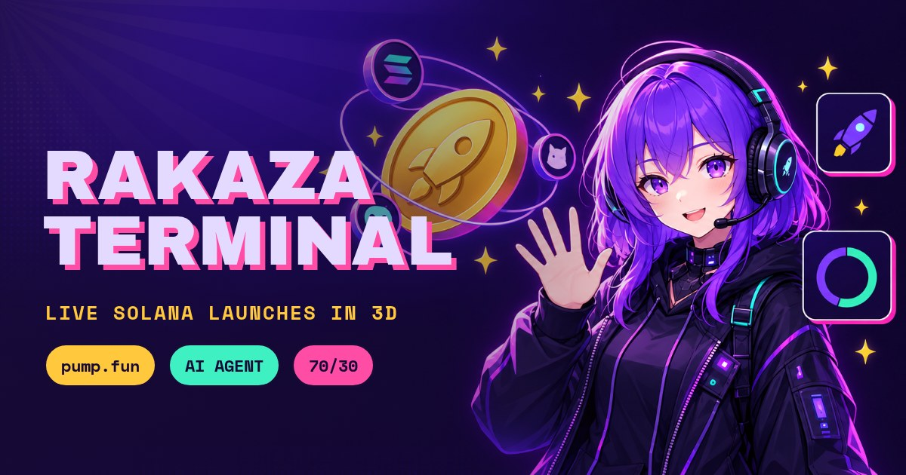
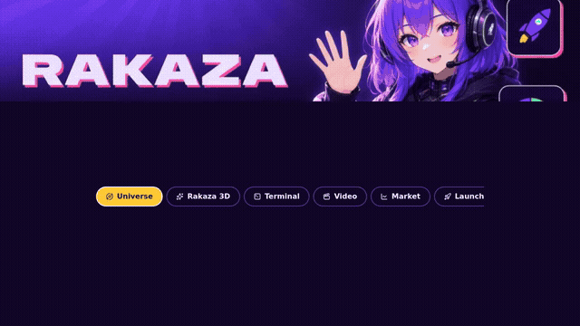
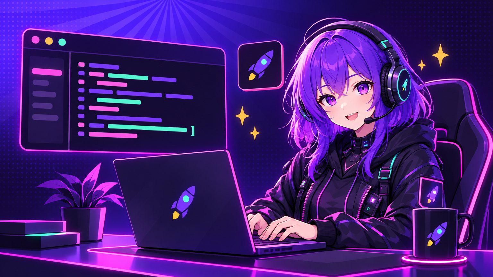

<p align="center"></p>

<h1 align="center">WhoopRakazaTerminaln</h1>
<p align="center"><b>A mobile-first 3D app for the Rakaza AI Terminal.</b><br>Fly through live Solana launches, meet Rakaza in 3D, run a demo terminal that opens a localhost, watch the tour, and ask a helper that knows the whole project.</p>
<p align="center">
  <a href="https://rakazaiterminal.whop.site/terminal"><b>Live app</b></a> ·
  <a href="https://github.com/Maliot100X/RakazaAiTerminal">Original project</a> ·
  <a href="https://rakaza-ai-terminal.vercel.app">Full terminal</a> ·
  <a href="docs/AGENT-BUILD.md">Agent build prompt</a>
</p>
<p align="center">
  
  
  
  
  
  
</p>

<p align="center"><a href="https://rakazaiterminal.whop.site/terminal"></a><br><sub>25 s of the real tour. The full 61 s video is <a href="public/media/rakaza-tour.mp4">public/media/rakaza-tour.mp4</a> and plays in the app's Video tab.</sub></p>

## What you get

| | |
|---|---|
|  | **Universe.** Live launches as coins orbiting a gold R coin in raw three.js. Tap a coin for details. The ring around a coin is its bonding-curve progress, a green glow means it graduated, shooting stars cross the sky. |
|  | **Rakaza 3D.** A VRM avatar that faces you, blinks, breathes, waves and talks (typed bubble, moving mouth, optional voice). She quotes the live SOL price. Framed from bone positions so she fits any screen. |
|  | **Terminal + localhost.** Type or tap `git clone`, `cd`, `npm install`, `npm run dev`. Then a browser frame for `localhost:3200` opens below with working pages: Home, Explore, Launch (dry run with the 70/30 maths), Agents, Leaderboard, all 68 pages of the real terminal, and Talk. **The install and dev server are a simulation, and the screen says so.** Data commands (`rakaza tokens`, `price`, `agents`, `board`) are real. |
|  | **Floating helper.** Ask how to change, set up or fix anything in the project. It answers from the project's own notes and the original terminal's docs, shows its source, can open a tab or run a terminal command for you, and never guesses. It is not an LLM; see [docs/BRAIN-UPGRADE.md](docs/BRAIN-UPGRADE.md). |

Also: **Video** (tour, promo, scenes, two songs with an equalizer, meme wall), **Market** (live SOL price and trending Solana tokens, with an offensive-name filter), **Launches / Agents / Community / Leaderboard**, **About**.

It is read-only: no wallet, no signing, no keys, no server code.

## One-command setup
```bash
curl -fsSL https://raw.githubusercontent.com/Maliot100X/WhoopRakazaTerminaln/main/scripts/setup.sh | bash
```
Then `npm run dev` and open <http://localhost:3000/terminal>. Needs Node 20+ (22 tested). Tested from a fresh clone with bun and with plain npm. Details and troubleshooting: [docs/SETUP.md](docs/SETUP.md).

## Where everything is
| Read | Why |
|---|---|
| [docs/AGENT-BUILD.md](docs/AGENT-BUILD.md) | The full prompt for an AI agent, with a one-click version for the Whop AI chat |
| [docs/LESSONS-AND-FIXES.md](docs/LESSONS-AND-FIXES.md) | 49 mistakes and their fixes, so the next builder skips them |
| [docs/SKILLS-RESEARCH.md](docs/SKILLS-RESEARCH.md) | Every skill and repo researched, which were cloned, run and applied, which were not |
| [docs/LINKS-AND-SOURCES.md](docs/LINKS-AND-SOURCES.md) | Every link you gave and its honest status |
| [DESIGN.md](DESIGN.md) | The design system as a DESIGN.md file for agents |
| [docs/ARCHITECTURE.md](docs/ARCHITECTURE.md) | Files, stack, design tokens |
| [docs/IMAGE-PROMPTS.md](docs/IMAGE-PROMPTS.md) | Exact prompts for the consistent images and the share card |
| [docs/DEPLOY-TO-WHOP.md](docs/DEPLOY-TO-WHOP.md) | Publishing and checking the share card |
| [docs/BRAIN-UPGRADE.md](docs/BRAIN-UPGRADE.md) | How to turn the helper into a real LLM chat (needs your key) |
| [docs/ROADMAP.md](docs/ROADMAP.md) | What is not done |

## Quality checks that were actually run
- `node tools/shot.mjs` real-browser screenshots (software WebGL) of every 3D tab at 390 and 1280 px, looked at by eye.
- `node tools/terminal-smoke.mjs` and `node tools/localhost-chat-smoke.mjs` drive the terminal, the localhost preview and the helper in a real browser.
- Hallmark `sloplint` on `src/`: 22 FAIL at the start, 0 FAIL now (see SKILLS-RESEARCH for the caveats).
- `node tools/record-tour.mjs` produces the tour video; ffmpeg converts it.

## Honest limits
The full Rakaza terminal cannot run on Whop hosting (Solana signing, database, Telegram, voice, keys). This app shows its live public data and links out for the rest. Not done: real three.ws animations on the avatar, a real LLM behind the helper, ports of the games, diary, live show and studio. See the roadmap.

## Credits and licences
Avatar: VRoid Project AvatarSample_B. Brand images, promo, songs, memes: from Maliot100X/RakazaAiTerminal. New scene images were generated from the repo's own image guide. Skill files under `docs/reference/` are copies kept for reference under their own licences (MIT / Apache-2.0). Fonts in `tools/_assets/`: SIL Open Font License.
